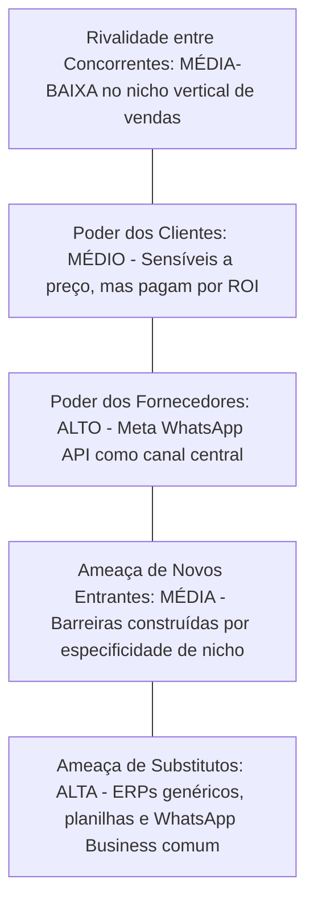

# OPPORTUNITY ASSESSMENT: PLATAFORMA DE ACELERAÇÃO DE RECEITA E CRM PARA LOJAS DE CELULARES

---

## 1. Declaração da Oportunidade
Lojas de celulares e revendedoras de iPhones (novos e seminovos) enfrentam uma crise crônica de compressão de margens e aumento vertiginoso do Custo de Aquisição de Clientes (CAC) em canais digitais (Meta Ads e Google Ads). Embora acumulem milhares de contatos qualificados e realizem vendas de alto ticket, operam de maneira amadora no pós-venda, mantendo bases de clientes inativas e perdendo até 70% dos orçamentos abertos no WhatsApp por falta de cadência de vendas e automação especializada.

Existe a oportunidade clara de construir um **Vertical SaaS de Aceleração de Receita & CRM Conversacional**, concebido especificamente para a dinâmica do comércio de smartphones, posicionando-se não como um sistema burocrático de gestão (ERP), mas como um motor direto de geração de lucro e retenção de clientes.

---

## 2. Dimensionamento de Mercado (TAM, SAM, SOM)

### 2.1 TAM (Total Addressable Market - Mercado Total Endereçável)
- **Escopo:** Todas as lojas de celulares, assistências técnicas com venda de aparelhos e revendedoras de smartphones independentes no Brasil.
- **Volume Estimado:** ~95.000 estabelecimentos formais e informais ativos no setor de comércio varejista especializado de equipamentos de telefonia e comunicação (CNAE 4752-1/00) e manutenção correlata.
- **Valor Potencial Anual:** 95.000 lojas × R$ 497/mês × 12 meses = **R$ 566,5 Milhões/ano**.

### 2.2 SAM (Serviceable Addressable Market - Mercado Endereçável Atendível)
- **Escopo:** Lojas de celulares com foco em iPhones novos/seminovos e smartphones premium, que possuem pelo menos 1 a 10 vendedores e utilizam WhatsApp ativamente como principal canal comercial (aproximadamente 30% do mercado geral).
- **Volume Estimado:** ~28.500 lojas estruturadas com faturamento mensal superior a R$ 50.000.
- **Valor Potencial Anual:** 28.500 lojas × R$ 497/mês × 12 meses = **R$ 170 Milhões/ano**.

### 2.3 SOM (Serviceable Obtainable Market - Mercado Obtido no Primeiro Ciclo)
- **Escopo:** Lojas no ecossistema de influência inicial, parcerias com fornecedores de atacado/distribuidores (como Balcão Phones e parceiros regionais) nos estados de SP, MG, RJ, PR, SC e GO nos primeiros 24 meses.
- **Volume Alvo (Objetivo de 24 meses):** 800 a 1.200 clientes ativos (MRR entre R$ 300k e R$ 500k).
- **Valor Anual:** 1.000 lojas × R$ 450/mês (ticket médio) × 12 meses = **R$ 5,4 Milhões/ano de ARR**.

---

## 3. Os 4 Grandes Riscos de Produto (Framework SVPG / Marty Cagan)

### 3.1 Risco de Valor (Value Risk)
*Os clientes comprarão e usarão a solução? Ela entrega valor perceptível rápido?*
- **Ameaça:** O lojista de celular é imediatista. Se o software exigir 3 semanas de parametrização sem gerar vendas nos primeiros 5 dias, ele cancelará o serviço no primeiro mês.
- **Mitigação de Produto:**
  - **"Time-to-First-Dollar" menor que 48 horas:** Funcionalidade de importação rápida de contatos antigos (CSV ou agenda) com um clique para disparar a primeira campanha de reativação (ex: "Semana da Bateria" ou "Renovação de Seminovos"), gerando vendas já no onboarding assistido.
  - O painel exibe em tempo real o **ROI Gerado**: métrica explícita indicando *"Vendas recuperadas este mês: R$ 48.900 | Custo da ferramenta: R$ 497"*.

### 3.2 Risco de Usabilidade (Usability Risk)
*Os usuários (vendedores de loja e proprietários) conseguirão operar a plataforma facilmente?*
- **Ameaça:** Vendedores de balcão e de WhatsApp têm perfil jovem, dinâmico, multitarefa e pouca tolerância a formulários densos. Softwares corporativos pesados são sumariamente abandonados.
- **Mitigação de Produto:**
  - Interface com UX similar a mensageiros modernos (estilo WhatsApp Web com sidebar contextual inteligente).
  - Ações com 1 clique: botão rápido "Calcular Parcelamento", botão "Enviar Proposta Trade-in", botão "Mover para Fechado".
  - Totalmente responsivo para que o vendedor possa atender tanto na frente da loja física pelo smartphone quanto no computador da recepção.

### 3.3 Risco de Viabilidade Técnica (Feasibility Risk)
*Temos capacidade de construir e sustentar a arquitetura com escalabilidade e confiabilidade?*
- **Ameaça:** Dependência crítica do canal WhatsApp. Disparos não oficiais (Web scraping / instâncias não autorizadas) levam a bloqueios de contas de WhatsApp Business dos lojistas, o que destrói o negócio do cliente e a reputação do SaaS.
- **Mitigação de Produto:**
  - Arquitetura desenhada com foco na **WhatsApp Cloud API Oficial** (Meta Business Platform / BSP parceiro), garantindo 100% de compliance, entrega garantida e ausência de risco de banimento de número.
  - Implementação de limites inteligentes de envio e cadências respeitosas de opt-in/opt-out.

### 3.4 Risco de Viabilidade do Negócio (Business Viability Risk)
*O modelo econômico funciona financeiramente, legalmente e estrategicamente para a nossa empresa?*
- **Custos de Infraestrutura e Mensagens:** Mensagens iniciadas pelo lojista na API oficial possuem custo por template (Meta Utility/Marketing).
- **Mitigação e Modelo Econômico:**
  - Precificação híbrida: Mensalidade fixa de SaaS para acesso à plataforma + franquia de créditos/mensagens ou modelo de repasse direto dos custos de mensagens Meta com margem de conveniência.
  - LTV/CAC projetado superior a 4.5x, com churn mensal projetado abaixo de 3.5% devido ao efeito "lock-in" do histórico de conversas e clientes.

---

## 4. Análise de Forças e Dinâmica de Mercado (5 Forças de Porter Adaptadas)

1. **Rivalidade de Concorrentes Diretos:** Baixa a moderada. Os softwares existentes atendem ordens de serviço (OS) e estoque (GestorOS, Balcão Phones, Shosp), mas nenhum domina o relacionamento, pós-venda preditivo e aceleração de receita via WhatsApp.
2. **Ameaça de Substitutos:** Alta no ponto de partida (planilha de Excel + WhatsApp Business gratuito no celular do lojista). A proposta deve ser radicalmente superior ao WhatsApp comum para justificar a adesão.
3. **Barreira de Entrada:** O conhecimento aprofundado dos meandros da venda de celulares (trade-in, garantia de seminovos, saúde de bateria, parcelamento com juros de maquininha) cria um fosso defensivo (moat) contra CRMs horizontais genéricos.

---

## 5. Estratégia de Monetização e Unit Economics Alvo

### 5.1 Planos Recomendados
- **Starter (R$ 297/mês):** Até 2 usuários, CRM completo com funil de vendas de celulares, automações básicas de pós-venda, 1 canal de WhatsApp oficial conectado.
- **Pro / Scale (R$ 597/mês):** Até 5 usuários, réguas ilimitadas de reativação, agente de IA para triagem noturna, cálculo avançado de trade-in, programa de indicação automático.
- **Enterprise / Multi-loja (R$ 997+/mês):** Múltiplas filiais, relatórios consolidados de desempenho por vendedor, API aberta para integração com ERP fiscal.

### 5.2 Metas de Unit Economics
- **CAC (Custo de Aquisição de Cliente):** < R$ 800 (com forte tração via parcerias com fornecedores atacadistas e canais de revenda).
- **ARPU (Receita Média por Usuário):** ~R$ 520/mês.
- **LTV (Lifetime Value):** > R$ 12.000 (considerando retenção média de 24+ meses).
- **Payback do CAC:** < 2 meses.

---

## 6. Conclusão do Assessment
A oportunidade é **altamente recomendada** para avanço na fase de Discovery. A solução não entra em concorrência direta com sistemas ERP consolidados, mas posiciona-se como um acelerador indispensável com posicionamento focado em aumento de margem e faturamento, categoria de software com maior propensão a pagamento e menor sensibilidade a preço no segmento de varejo de eletrônicos.
