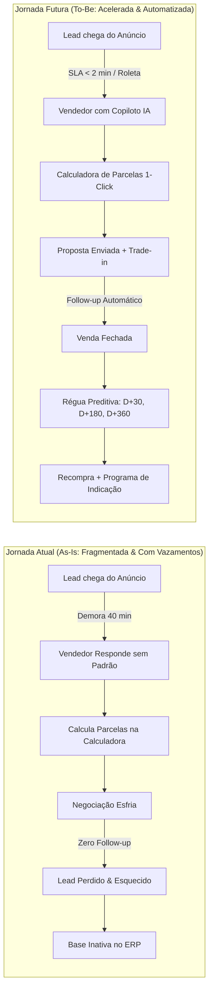

# USER JOURNEY: MAPEAMENTO DAS JORNADAS DO USUÁRIO

---

## 1. Visão Comparativa: Jornada Atual (As-Is) vs. Jornada Futura (To-Be)



---

## 2. Jornada Detalhada do Vendedor no Atendimento Comercial (To-Be)

### Etapa 1: Recepção e Distribuição do Lead (Tempo: 0 a 2 min)
- **Ação do Sistema:** O lead clica no anúncio do Instagram ou link da bio e envia mensagem no WhatsApp.
- **Automação:** A roleta inteligente identifica qual vendedor está disponível na escala da loja e atribui a conversa imediatamente, notificando na tela do vendedor e emitindo alerta sonoro discreto.
- **Gatilho de IA (Opcional fora de horário):** Se for após as 20h, o agente de IA acolhe, coleta o interesse (ex: "Busco iPhone 13 128GB na cor Estelar") e confirma que o vendedor entrará em contato às 08h30 com a melhor condição.
- **Touchpoint:** WhatsApp Oficial + Inbox Web do Vendedor.

### Etapa 2: Qualificação & Cálculo de Proposta Assistida (Tempo: 2 a 10 min)
- **Ação do Vendedor:** O vendedor visualiza na barra lateral o perfil do cliente (se for recorrente, vê o histórico completo; se for novo, vê a origem da campanha).
- **Ferramenta de 1 Clique:**
  - O vendedor clica em **"Simular Condição"**.
  - Seleciona o aparelho desejado (ex: *iPhone 14 128GB Estelar - R$ 3.899*).
  - Insere o aparelho na troca (ex: *iPhone 11 64GB com 82% de bateria - Avaliação: R$ 1.300*).
  - Seleciona a forma de pagamento da diferença: *R$ 500 no Pix + Restante em 12x no cartão*.
  - O sistema calcula instantaneamente com a taxa exata cadastrada da maquininha da loja e gera um layout de mensagem pronto:
    > *"Fala, Carlos! Fiz uma condição imperdível para você:*
    > *📱 iPhone 14 128GB Estelar Lacrado*
    > *🔄 Seu iPhone 11 entra por R$ 1.300*
    > *💰 Diferença: R$ 500 no Pix + 12x de R$ 209,90 no cartão.*
    > *Podemos reservar o seu aparelho agora para você retirar na loja hoje?"*

### Etapa 3: Gestão do Funil e Fechamento (Tempo: 10 min a 24 horas)
- **Se o cliente não responder na hora:** O sistema agenda automaticamente lembretes suaves no WhatsApp (D+1 e D+3) com gatilhos de escassez respeitosa (*"Carlos, temos apenas 2 unidades do iPhone 14 nessa cor em estoque. Quer que eu segure a sua reserva até às 17h?"*).
- **Se fechou a venda:** O vendedor arrasta o card para a coluna **"Venda Concluída"**. Um pop-up rápido pede apenas 3 informações essenciais (Modelo vendido, IMEI e Saúde da Bateria se for seminovo).

---

## 3. Jornada de Pós-Venda, Reativação e Ciclo de Vida do Aparelho (Lifecycle)

A relação com o cliente não termina na entrega; ela se inicia formalmente:

| Marco Temporal | Objetivo Estratégico | Conteúdo da Automação WhatsApp | Métrica de Sucesso |
| :--- | :--- | :--- | :--- |
| **D+0 (Imediato)** | Encantamento & Garantia | Envio do Termo de Garantia digital + Dicas de primeiro uso e cuidados com a bateria. | Taxa de abertura: 98% |
| **D+7 (Semana 1)** | CS & Verificação | *"Passando para saber se você está amando seu novo iPhone! Deu tudo certo com a migração de fotos?"* | NPS / Satisfação do Cliente |
| **D+15 (Acessórios)** | Venda Adicional (Cross-sell) | Oferta de carregador turbo homologado Apple ou fonte por indução com 20% de desconto. | Conversão em Acessórios (+ R$ 150 LTV) |
| **D+60 (Película)** | Manutenção Preventiva | Lembrete de verificação de película de vidro e limpeza do conector de carga na loja física. | Tráfego na loja física |
| **D+180 (6 Meses)** | Check-up Semestral | Convite para higienização e diagnóstico gratuito da bateria na loja. | Relacionamento ativo |
| **D+360 (1 Ano)** | **UPGRADE PREDITIVO** | *"Seu iPhone 13 acabou de completar 1 ano! Avaliamos ele com super bônus para você dar um salto para a linha 15."* | **Taxa de Recompra (Reativação)** |

---

## 4. Jornada do Programa de Indicação (Member-Get-Member)

```
[Cliente Compra iPhone] 
       │
       ▼ (D+1 após a compra)
[Recebe WhatsApp: Link de Embaixador da Loja]
       │
       ▼
[Cliente compartilha no WhatsApp com Amigo/Familiar]
       │
       ▼
[Amigo clica no link e cai no WhatsApp da Loja com Cupom]
       │
       ▼
[Amigo fecha a compra do novo aparelho]
       │
       ▼
[O Sistema credita R$ 100 de Cashback/Pix para o Indicador e Notifica Ambos]
```

### Por que essa jornada é imbatível para o lojista?
1. **Confiança Imediata:** O amigo indicado não vem frio do tráfego pago; ele já confia na recomendação de quem comprou.
2. **Custo de Aquisição Fixo e Garantido:** O lojista só paga o incentivo de indicação (ex: R$ 100) **após** o dinheiro da nova venda de R$ 3.500 entrar no caixa da loja. O CAC torna-se 100% variável e rentável.
