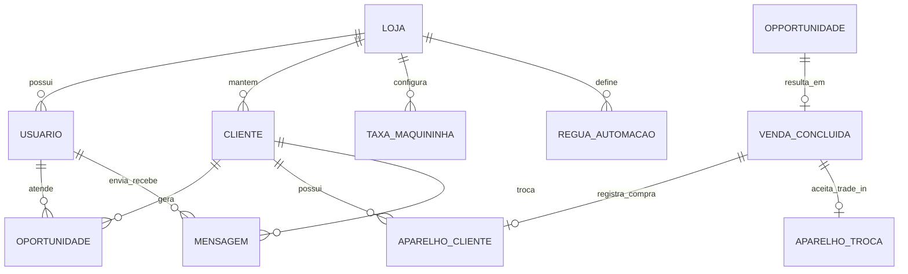
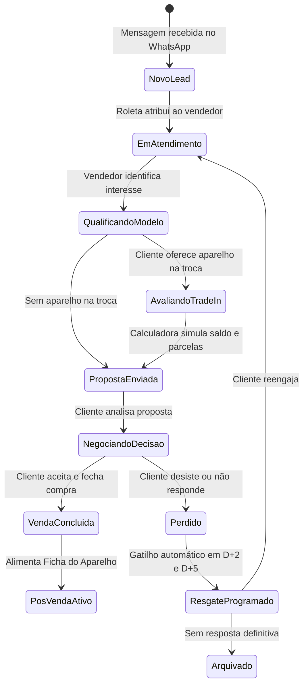
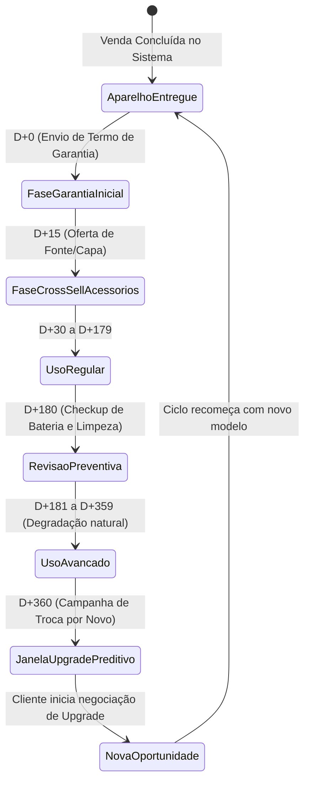
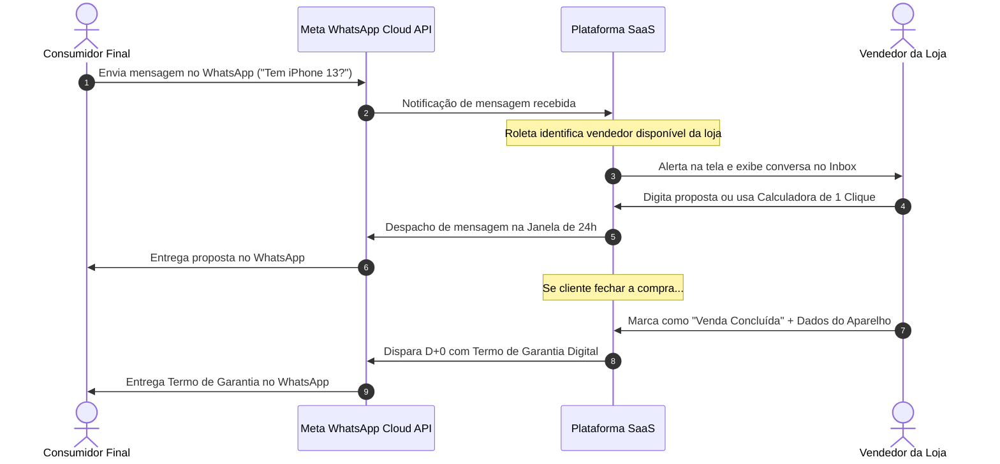

# CONCEPTUAL DATA & FLOWS: MODELAGEM CONCEITUAL DE DOMÍNIO E FLUXOS DE PRODUTO

---

## 1. Modelo Conceitual de Domínio (Entidades de Negócio)

### 1.1 Descrição das Entidades Conceituais de Negócio

1. **Loja (Tenant):** O estabelecimento comercial de celulares. Agrupa a conta comercial oficial de WhatsApp (WABA), as regras de negócio, a escala de vendedores e as taxas de máquina de cartão.
2. **Usuário (Operador / Vendedor / Gerente):** Membro da equipe da loja com perfil de acesso definido (Admin, Gerente ou Vendedor) e status de disponibilidade na roleta.
3. **Cliente (Consumidor Final):** Contato associado a um número de telefone com histórico acumulado de compras, modelos de smartphone possuídos, tags de preferência e status de consentimento (Opt-in / Opt-out).
4. **Oportunidade (Lead / Negociação no Kanban):** Registro temporário do ciclo de venda, com modelo de interesse, valor potencial, vendedor responsável, etapa atual do funil e motivo de perda (quando aplicável).
5. **Aparelho do Cliente (Device Lifecycle):** Registro físico do smartphone do cliente com marca, modelo, capacidade de armazenamento, condição (novo ou seminovo), IMEI e saúde da bateria no momento da venda. É a entidade que dispara as réguas preditivas de pós-venda.
6. **Venda Concluída:** Registro da transação com data de entrega, valor final, forma de pagamento, comissão e link com o termo de garantia emitido.
7. **Régua de Automação:** Definição do gatilho temporal (D+0, D+15, D+180, D+360), modelo de template oficial da Meta associado e condições de disparo.

---

## 2. Diagrama Conceitual de Estados: Ciclo de Vida da Oportunidade (Lead)

---

## 3. Diagrama Conceitual de Estados: Ciclo de Vida do Aparelho (Device Lifecycle)

---

## 4. Fluxo Conceitual de Comunicação com a Meta WhatsApp Cloud API

---

## 5. Diretrizes de Coexistência com ERPs de Mercado

A plataforma opera em regime de **coexistência não-invasiva** com os sistemas ERP existentes na loja (ex: Balcão Phones, Bling, GestorOS):
- O lojista pode manter seu ERP fiscal para emissão de NF-e e controle de estoque de peças.
- A plataforma atua na camada frontal (*front-office*) de relacionamento, atração, fechamento de vendas e retenção preditiva.
- Na V1, a importação inicial de contatos antigos é suportada via arquivo CSV padronizado (com nome, telefone, modelo e data da última compra).
- Nas fases seguintes (V1.5 e V2), conectores via webhooks permitirão a sincronização automática de vendas entre a plataforma e os principais ERPs do setor.
