# SITE MAP & NAVIGATION: ARQUITETURA DE INFORMAÇÃO E TAXONOMIA (V1)

---

## 1. Visão Geral da Arquitetura de Navegação

A arquitetura de navegação foi projetada sob o princípio de **Fricção Zero para Vendas**. O vendedor de loja física não pode navegar por múltiplos menus aninhados ou perder tempo em transições lentas de tela. O sistema adota um padrão de **Navegação Principal Lateral Compacta (Desktop)** e **Barra Inferior de Atalhos Rápidos (Mobile PWA)**.

```mermaid
graph TD
    ROOT[Plataforma SaaS Comercial]
    
    ROOT --> INBOX[1. Inbox Comercial WhatsApp]
    ROOT --> FUNIL[2. Pipeline / Funil de Celulares]
    ROOT --> CLIENTES[3. Clientes & Ciclo do Aparelho]
    ROOT --> REGUAS[4. Automações & Reativação]
    ROOT --> DASHBOARD[5. Dashboard de ROI & Equipe]
    ROOT --> CONFIG[6. Configurações da Loja]

    INBOX --> INBOX_FILAS[Fila de Atendimento / Minhas Conversas / SLA]
    INBOX --> INBOX_CHAT[Janela de Chat + Calculadora Lateral de Parcela]
    
    FUNIL --> KANBAN_VIEW[Visão Kanban por Estágios de Venda de Celular]
    FUNIL --> LOST_REASONS[Visão de Negócios Perdidos / Resgate]

    CLIENTES --> CLIENTES_LISTA[Base Unificada de Contatos]
    CLIENTES --> CLIENTES_IMPORT[Importador CSV de Base Antiga]
    CLIENTES --> CLIENTES_FICHA[Ficha do Cliente + Linha do Tempo do Aparelho]

    REGUAS --> REGUAS_NATIVAS[Réguas Nativas: D+0, D+15, D+180, D+360]
    REGUAS --> REGUAS_RESGATE[Régua de Resgate de Orçamentos: D+2 e D+5]
    REGUAS --> REGUAS_MGM[Indicação Lite: Links e Cupons Emitidos]

    DASHBOARD --> DASH_ROI[Card de Retorno Financeiro / Vendas Recuperadas]
    DASHBOARD --> DASH_TEAM[Tabela de SLA e Conversão por Vendedor]

    CONFIG --> CONFIG_WABA[Conexão Meta WhatsApp Cloud API]
    CONFIG --> CONFIG_TAXAS[Tabela de Taxas de Maquininha / Juros]
    CONFIG --> CONFIG_ROLETA[Escala de Vendedores & Regras da Roleta]
    CONFIG --> CONFIG_LOJA[Dados da Loja & Perfil]
```

---

## 2. Taxonomia e Detalhamento das Seções

### 2.1 Seção 1: Inbox Comercial WhatsApp (`/inbox`)
- **Objetivo:** O coração operacional diário do vendedor e atendente.
- **Sub-estruturas:**
  - **Minhas Conversas:** Conversas ativas atribuídas ao vendedor logado.
  - **Fila Geral / Não Atribuídas:** Conversas que aguardam atribuição ou transbordo de SLA.
  - **Painel de Filtros:** Filtro por vendedor, por tag (`#Tem-Troca`, `#iPhone-14`), e por status de SLA (Verde, Amarelo, Vermelho).
  - **Gaveta Lateral de Venda:** Acesso imediato à Calculadora de Maquininha e Ficha Rápida do Cliente sem sair da conversa.

### 2.2 Seção 2: Pipeline Comercial de Celulares (`/pipeline`)
- **Objetivo:** Gestão visual do fluxo de oportunidades em formato Kanban.
- **Colunas Oficiais:**
  1. *Novo Lead*
  2. *Qualificando Modelo*
  3. *Avaliando Trade-in*
  4. *Proposta Enviada*
  5. *Aguardando Decisão / Reserva*
  6. *Venda Concluída*
  7. *Perdido / Descarte*
- **Ações Rápidas nos Cards:** Mover de etapa, abrir chat direto no Inbox, marcar motivo de perda e visualizar valor da proposta.

### 2.3 Seção 3: Clientes & Ciclo do Aparelho (`/clientes`)
- **Objetivo:** Gestão da carteira permanente de clientes e dos smartphones vendidos.
- **Sub-estruturas:**
  - **Diretório de Clientes:** Busca instantânea por Nome, Telefone, Modelo do Aparelho ou IMEI.
  - **Ficha do Cliente:** Dados cadastrais, tags de interesse, data da última compra e status de opt-in.
  - **Ficha do Aparelho (Device Profile):** Modelo exato, capacidade, cor, novo/seminovo, saúde da bateria registrada e histórico de réguas disparadas.
  - **Área de Ingestão CSV (`/clientes/importar`):** Upload guiado de planilhas de bases legadas com preview e validação de números.

### 2.4 Seção 4: Automações & Reativação (`/automacoes`)
- **Objetivo:** Supervisão e configuração das réguas de mensagens automáticas no WhatsApp.
- **Sub-estruturas:**
  - **Painel de Réguas Nativas:** Toggle Liga/Desliga para cada régua (D+0, D+15, D+180, D+360, D+2/D+5).
  - **Editor de Parâmetros:** Personalização de variáveis no template oficial Meta (ex: nome do cliente, modelo do aparelho, valor do voucher).
  - **Módulo Indicação Lite:** Acompanhamento de embaixadores ativos, cliques nos links de indicação e cupons convertidos em vendas.

### 2.5 Seção 5: Dashboard Executivo de ROI (`/dashboard`)
- **Objetivo:** Prova irrefutável de valor para o proprietário e controle de metas para o gerente.
- **Componentes de Navegação:**
  - Seletor de Período (Hoje, Últimos 7 dias, Este Mês, Mês Anterior).
  - Bloco de Destaque: *ROI das Automações* (Vendas resgatadas vs Custo do software).
  - Bloco de Equipe: *Ranking de Vendedores* (Volume de leads, tempo médio de resposta, conversão e vendas fechadas).

### 2.6 Seção 6: Configurações da Loja (`/configuracoes`)
- **Objetivo:** Parametrização da operação e integrações.
- **Sub-abas:**
  - **WhatsApp API:** Status da conta WABA, limite de mensagens diárias da Meta e número conectado.
  - **Taxas de Maquininha:** Tabela de juros de 1x a 21x da adquirente da loja (Stone, Cielo, PagBank, InfinitePay).
  - **Equipe & Roleta:** Cadastro de usuários, atribuição de perfis (Admin, Gerente, Vendedor) e chave liga/desliga de recebimento de leads na roleta.

---

## 3. Matriz de Acesso e Permissões de Navegação por Papel

| Rota / Seção | Dono / Administrador | Gerente de Loja | Vendedor / Balcão |
| :--- | :---: | :---: | :---: |
| `/inbox` (Todas as Conversas da Loja) | **Acesso Total** | **Acesso Total** | Restrito às suas conversas |
| `/pipeline` (Visão Geral de Todas as Vendas) | **Acesso Total** | **Acesso Total** | Visualiza apenas seus cards |
| `/clientes` (Listagem e Fichas) | **Acesso Total** | **Acesso Total** | Apenas consulta pontual |
| `/clientes/importar` (Upload CSV) | **Acesso Total** | **Acesso Total** | Sem Acesso |
| `/automacoes` (Gestão de Réguas) | **Acesso Total** | **Acesso Total** | Sem Acesso |
| `/dashboard` (Métricas Financeiras & ROI) | **Acesso Total** | **Acesso Total** | Sem Acesso |
| `/configuracoes/taxas` (Taxas de Maquininha) | **Acesso Total** | **Acesso Total** | Apenas Leitura na Calculadora |
| `/configuracoes/waba` (Conexão Meta API) | **Acesso Total** | Sem Acesso | Sem Acesso |
