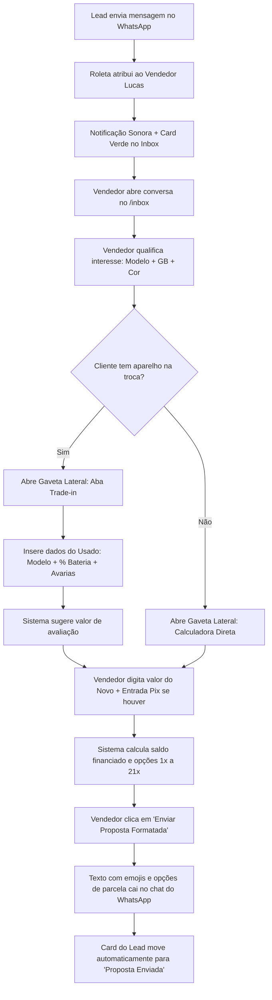
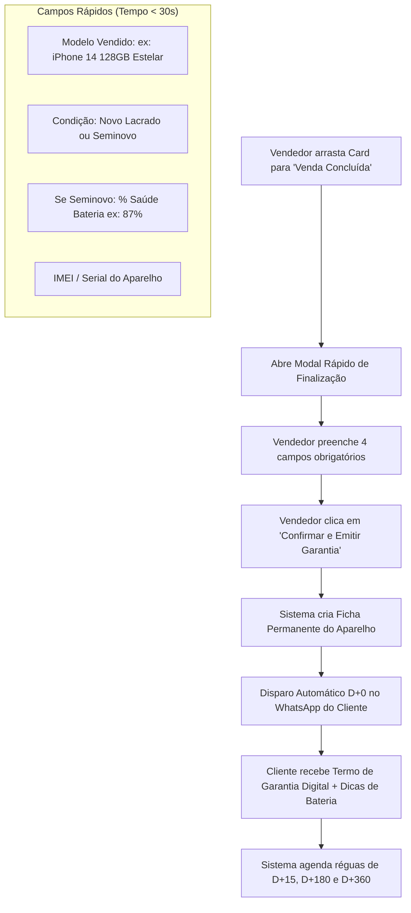
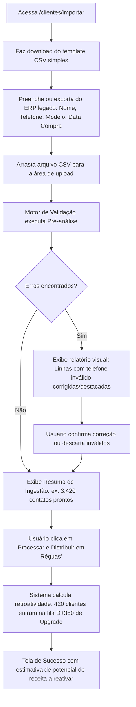
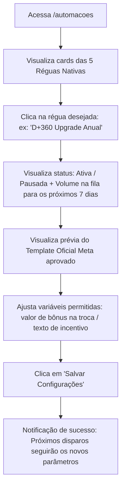
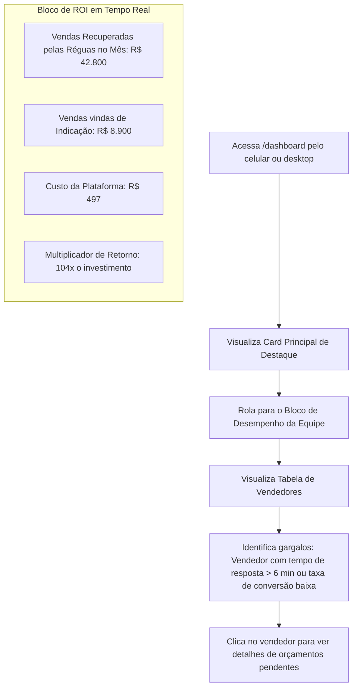

# USER FLOWS: MAPEAMENTO DE FLUXOS DE INTERAÇÃO E DECISÃO (V1)

---

## 1. Fluxo 1: Atendimento, Qualificação e Envio de Proposta no WhatsApp (Vendedor)

- **Ator:** Vendedor de Balcão / Atendente de WhatsApp (Lucas).
- **Gatilho:** Novo lead envia mensagem no WhatsApp da loja interessado em comprar um smartphone.
- **Objetivo:** Responder em menos de 2 minutos, qualificar necessidade, calcular parcelamento/trade-in e enviar proposta formatada.

---

## 2. Fluxo 2: Conclusão de Venda, Registro do Aparelho e Ativação de Pós-Venda

- **Ator:** Vendedor de Balcão (Lucas).
- **Gatilho:** Cliente aceitou a proposta e efetuou o pagamento na loja física ou via motoboy/link.
- **Objetivo:** Registrar a venda em menos de 30 segundos, alimentar a Ficha do Aparelho e acionar o ciclo D+0.

---

## 3. Fluxo 3: Onboarding & Ingestão da Base Histórica via CSV

- **Ator:** Gerente Comercial (Camila) ou Proprietário (Rodrigo).
- **Gatilho:** Primeiro acesso à plataforma ou migração de clientes do ERP anterior (ex: Balcão Phones, Bling).
- **Objetivo:** Importar de 1.000 a 15.000 contatos legados e ativar réguas de reativação imediatamente.

---

## 4. Fluxo 4: Configuração e Monitoramento de Réguas de Reativação

- **Ator:** Gerente de Loja (Camila).
- **Gatilho:** Rotina semanal de acompanhamento comercial ou ativação de campanhas.
- **Objetivo:** Ajustar parâmetros das réguas nativas e conferir disparos agendados.

---

## 5. Fluxo 5: Acompanhamento de ROI e Performance da Equipe (Dono da Loja)

- **Ator:** Proprietário da Loja (Rodrigo).
- **Gatilho:** Verificação diária ou semanal do retorno financeiro do negócio.
- **Objetivo:** Comprovar que o software está se pagando e auditar o SLA de resposta dos vendedores.

