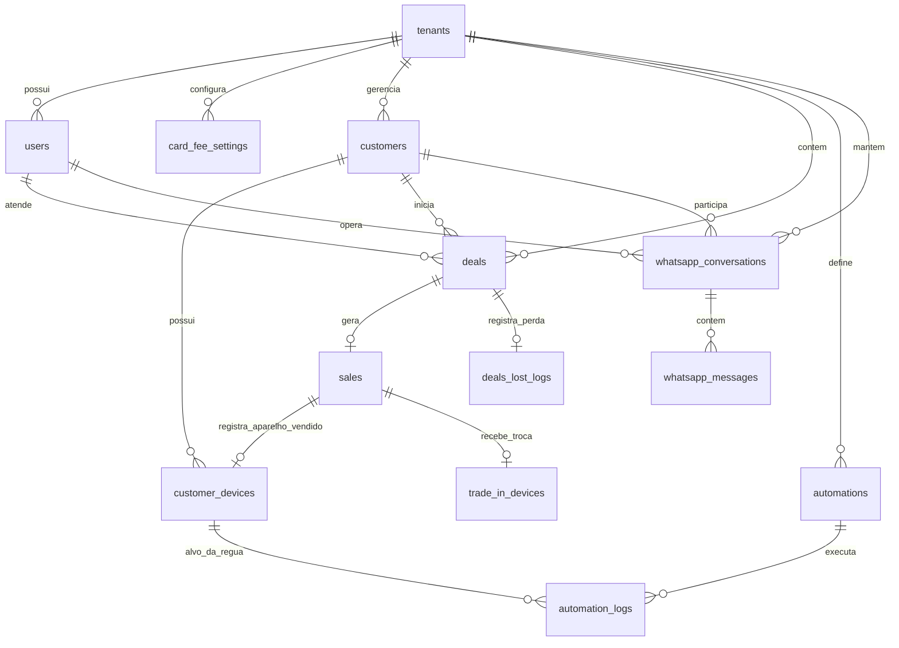

# DATA ARCHITECTURE & SCHEMA: MODELO DE DADOS E DICIONÁRIO DE TABELAS (V1)

---

## 1. Diagrama Entidade-Relacionamento Técnico (ERD)

---

## 2. Dicionário de Dados e Estrutura das Tabelas Principais

### 2.1 Tabela: `tenants` (Lojas / Contas Comerciais)
- Armazena as informações das lojas contratantes da plataforma.
- **Campos Principais:**
  - `id` (UUID, Primary Key)
  - `name` (VARCHAR 255 - Nome fantasia da loja)
  - `cnpj` (VARCHAR 18, UNIQUE - Documento fiscal)
  - `waba_id` (VARCHAR 100 - WhatsApp Business Account ID na Meta)
  - `phone_number_id` (VARCHAR 100 - ID do número na Meta Cloud API)
  - `phone_number` (VARCHAR 20 - Número formatado com DDI/DDD)
  - `waba_access_token` (TEXT, Criptografado AES-256 - Token permanente de API)
  - `status` (VARCHAR 30 - `active`, `suspended`, `trial`)
  - `created_at`, `updated_at` (TIMESTAMP WITH TIME ZONE)

### 2.2 Tabela: `users` (Operadores da Loja)
- Usuários autenticados no sistema (Dono, Gerentes e Vendedores).
- **Campos Principais:**
  - `id` (UUID, Primary Key)
  - `tenant_id` (UUID, Foreign Key -> `tenants.id`, Not Null)
  - `name` (VARCHAR 255)
  - `email` (VARCHAR 255, UNIQUE por tenant)
  - `password_hash` (VARCHAR 255 - Hash seguro Argon2id ou Bcrypt)
  - `role` (VARCHAR 30 - `admin`, `manager`, `seller`)
  - `is_available_in_rotation` (BOOLEAN, Default: true - Status para a roleta)
  - `max_active_chats` (INTEGER, Default: 20 - Teto de conversas abertas)
  - `created_at`, `updated_at` (TIMESTAMP WITH TIME ZONE)

### 2.3 Tabela: `card_fee_settings` (Taxas de Maquininha da Loja)
- Guarda a tabela de juros de cartão e máquina da loja para a Calculadora de 1 Clique.
- **Campos Principais:**
  - `id` (UUID, Primary Key)
  - `tenant_id` (UUID, Foreign Key -> `tenants.id`, Not Null)
  - `installment_number` (INTEGER - Faixa: 1 para à vista, até 21 parcelas)
  - `fee_percentage` (NUMERIC(5,2) - Ex: 12.50 para 12,50% de juros da máquina)
  - `created_at`, `updated_at` (TIMESTAMP WITH TIME ZONE)

### 2.4 Tabela: `customers` (Consumidores Finais)
- Base de dados permanente dos clientes da loja.
- **Campos Principais:**
  - `id` (UUID, Primary Key)
  - `tenant_id` (UUID, Foreign Key -> `tenants.id`, Not Null)
  - `name` (VARCHAR 255)
  - `phone_number` (VARCHAR 25, Not Null - Padrão internacional E.164: +5511999999999)
  - `opt_in_status` (VARCHAR 20, Default: `subscribed` - `subscribed` ou `opted_out`)
  - `referral_code` (VARCHAR 50, UNIQUE - Código de indicação único do cliente)
  - `referred_by_customer_id` (UUID, Foreign Key -> `customers.id`, Nullable)
  - `created_at`, `updated_at` (TIMESTAMP WITH TIME ZONE)

### 2.5 Tabela: `customer_devices` (Ficha do Aparelho & Ciclo de Vida)
- O coração do CRM: registra cada smartphone vendido ou sob posse do cliente.
- **Campos Principais:**
  - `id` (UUID, Primary Key)
  - `tenant_id` (UUID, Foreign Key -> `tenants.id`, Not Null)
  - `customer_id` (UUID, Foreign Key -> `customers.id`, Not Null)
  - `brand` (VARCHAR 50 - Ex: `Apple`, `Samsung`)
  - `model_name` (VARCHAR 100 - Ex: `iPhone 14`, `Galaxy S23`)
  - `storage_capacity` (VARCHAR 20 - Ex: `128GB`, `256GB`)
  - `color` (VARCHAR 50)
  - `condition` (VARCHAR 30 - `new_sealed`, `certified_pre_owned`)
  - `battery_health_percentage` (INTEGER - Ex: 88, obrigatório para seminovos)
  - `imei_serial` (VARCHAR 50 - Número de identificação e garantia)
  - `sold_at` (TIMESTAMP WITH TIME ZONE - Data oficial de entrega da compra)
  - `created_at`, `updated_at` (TIMESTAMP WITH TIME ZONE)

### 2.6 Tabela: `deals` (Oportunidades Comerciais / Kanban)
- Negociações no funil de vendas.
- **Campos Principais:**
  - `id` (UUID, Primary Key)
  - `tenant_id` (UUID, Foreign Key -> `tenants.id`, Not Null)
  - `customer_id` (UUID, Foreign Key -> `customers.id`, Not Null)
  - `assigned_user_id` (UUID, Foreign Key -> `users.id`, Nullable - Vendedor responsável)
  - `stage` (VARCHAR 50 - `new_lead`, `qualifying`, `trade_in_eval`, `proposal_sent`, `waiting_decision`, `won`, `lost`)
  - `target_model` (VARCHAR 100 - Modelo desejado pelo lead)
  - `estimated_deal_value` (NUMERIC(10,2))
  - `created_at`, `updated_at` (TIMESTAMP WITH TIME ZONE)

### 2.7 Tabela: `sales` (Vendas Fechadas e Atribuição de ROI)
- Registro financeiro da venda consolidada.
- **Campos Principais:**
  - `id` (UUID, Primary Key)
  - `tenant_id` (UUID, Foreign Key -> `tenants.id`, Not Null)
  - `deal_id` (UUID, Foreign Key -> `deals.id`, Not Null)
  - `customer_id` (UUID, Foreign Key -> `customers.id`, Not Null)
  - `seller_user_id` (UUID, Foreign Key -> `users.id`, Not Null)
  - `total_gross_amount` (NUMERIC(10,2) - Valor total bruto da transação)
  - `attribution_type` (VARCHAR 50 - `organic_inbound`, `reactivation_rule`, `referral_lead`)
  - `automation_log_id` (UUID, Foreign Key -> `automation_logs.id`, Nullable)
  - `closed_at` (TIMESTAMP WITH TIME ZONE)

### 2.8 Tabela: `trade_in_devices` (Aparelhos Recebidos na Troca)
- Registra o smartphone dado pelo cliente como entrada na negociação.
- **Campos Principais:**
  - `id` (UUID, Primary Key)
  - `tenant_id` (UUID, Foreign Key -> `tenants.id`, Not Null)
  - `sale_id` (UUID, Foreign Key -> `sales.id`, Not Null)
  - `model_name` (VARCHAR 100)
  - `battery_health` (INTEGER)
  - `trade_in_value_credited` (NUMERIC(10,2) - Valor abatido da venda)
  - `imei_serial` (VARCHAR 50)
  - `defects_notes` (TEXT - Riscos na tela, Face ID, etc.)

### 2.9 Tabela: `automations` & `automation_logs`
- Gerencia réguas nativas e a auditoria de cada disparo realizado.
- **Campos Principais em `automations`:**
  - `id` (UUID, Primary Key)
  - `tenant_id` (UUID, Foreign Key -> `tenants.id`, Not Null)
  - `trigger_type` (VARCHAR 50 - `d0_welcome`, `d15_accessories`, `d180_checkup`, `d360_upgrade`, `lost_recovery`)
  - `is_active` (BOOLEAN, Default: true)
  - `meta_template_name` (VARCHAR 100 - Nome do template aprovado na Meta)
- **Campos Principais em `automation_logs`:**
  - `id` (UUID, Primary Key)
  - `tenant_id` (UUID, Foreign Key -> `tenants.id`, Not Null)
  - `automation_id` (UUID, Foreign Key -> `automations.id`, Not Null)
  - `customer_device_id` (UUID, Foreign Key -> `customer_devices.id`, Nullable)
  - `status` (VARCHAR 30 - `scheduled`, `sent`, `delivered`, `read`, `failed`)
  - `wamid` (VARCHAR 150 - ID da mensagem fornecido pela Meta)
  - `sent_at` (TIMESTAMP WITH TIME ZONE)

### 2.10 Tabelas: `whatsapp_conversations` & `whatsapp_messages`
- Persistência das mensagens trocadas na interface do Inbox.
- **Campos em `whatsapp_conversations`:**
  - `id` (UUID, Primary Key)
  - `tenant_id` (UUID, Foreign Key -> `tenants.id`, Not Null)
  - `customer_id` (UUID, Foreign Key -> `customers.id`, Not Null)
  - `assigned_user_id` (UUID, Foreign Key -> `users.id`, Nullable)
  - `sla_status` (VARCHAR 20 - `green`, `yellow`, `red`)
  - `last_customer_message_at` (TIMESTAMP WITH TIME ZONE)
  - `last_message_preview` (TEXT)
- **Campos em `whatsapp_messages`:**
  - `id` (UUID, Primary Key)
  - `tenant_id` (UUID, Foreign Key -> `tenants.id`, Not Null)
  - `conversation_id` (UUID, Foreign Key -> `whatsapp_conversations.id`, Not Null)
  - `wamid` (VARCHAR 150, UNIQUE - Identificador único de mensagem Meta)
  - `sender_type` (VARCHAR 20 - `customer`, `agent`, `automation`)
  - `message_type` (VARCHAR 20 - `text`, `image`, `audio`, `document`, `template`)
  - `body` (TEXT)
  - `media_url` (TEXT, Nullable)
  - `status` (VARCHAR 20 - `sent`, `delivered`, `read`, `failed`)
  - `created_at` (TIMESTAMP WITH TIME ZONE)

---

## 3. Estratégia de Indexação e Particionamento

1. **Índice Composto Obrigatório por Tenant:**
   - Em todas as tabelas: `CREATE INDEX idx_[tabela]_tenant ON [tabela] (tenant_id, id);`
   - Otimiza as consultas filtradas pelo contexto de sessão do PostgreSQL RLS.
2. **Índices de Busca Rápida no Inbox e CRM:**
   - `customers`: Índice B-Tree em `(tenant_id, phone_number)` para identificar clientes em menos de 5ms na chegada de um webhook.
   - `whatsapp_conversations`: Índice em `(tenant_id, assigned_user_id, last_customer_message_at DESC)` para ordenação instantânea da lista de conversas.
   - `whatsapp_messages`: Índice UNIQUE em `(wamid)` para **desduplicação de webhooks (idempotência)**.
3. **Particionamento de Tabelas de Alto Volume:**
   - A tabela `whatsapp_messages` é estruturada com particionamento declarativo por intervalo de datas (`RANGE (created_at)` mensal), garantindo que consultas em mensagens recentes nunca percam performance mesmo após anos de operação e milhões de linhas gravadas.
