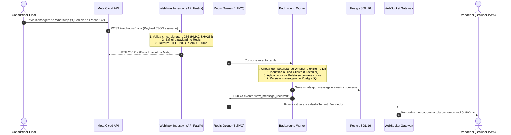

# META WHATSAPP INTEGRATION DESIGN: ARQUITETURA DE INTEGRAÇÃO OFICIAL (V1)

---

## 1. Visão Geral da Integração com a Meta Cloud API

A comunicação com o WhatsApp é baseada **estritamente na Meta WhatsApp Cloud API Oficial** (Graph API v19+), operando diretamente com a infraestrutura oficial da Meta.



---

## 2. Pipeline de Resiliência, Concorrência e Idempotência

### 2.1 Desacoplamento da Ingestão de Webhooks
- **O Problema:** A Meta exige resposta `HTTP 200 OK` em menos de **3.000 milissegundos**. Se o backend travar em consultas de banco de dados ou operações síncronas lentas, a Meta considera o webhook falho e inicia retentativas agressivas em cascata, provocando tempestades de requisições duplicadas.
- **A Solução:** O endpoint `/webhooks/meta` executa apenas duas tarefas atômicas:
  1. Valida a assinatura de segurança `x-hub-signature-256` utilizando o App Secret da Meta.
  2. Publica o payload bruto em uma fila Redis (`bullmq:webhook-incoming-queue`).
  3. Retorna imediatamente `HTTP 200 OK` (latência típica: **15 a 45 milissegundos**).

### 2.2 Desduplicação Estrita por WAMID (Idempotência)
- Toda mensagem recebida da Meta possui um identificador global único chamado `wamid` (ex: `wamid.HBgL...`).
- Antes de gravar ou notificar o vendedor, o Worker executa uma operação atômica de chave no Redis ou consulta com índice único no PostgreSQL:
  - Se o `wamid` já existir: o evento é descartado com log de desduplicação (`ACK`).
  - Se for inédito: o processamento comercial prossegue normalmente.

---

## 3. Gestão da Janela de 24 Horas e Templates Oficiais

```mermaid
graph TD
    A[Tentativa de Envio de Mensagem para Cliente] --> B{Última mensagem do cliente foi há < 24h?}
    
    B -- Sim (Dentro da Janela 24h) --> C[Mensagem de Formato Livre]
    C --> D[Permite Texto Livre, Áudio, Foto de Aparelho ou Proposta]
    D --> E[Despacho Direto via Endpoint /messages com type: text/image]
    
    B -- Não (Fora da Janela 24h) --> F{É uma Régua ou Resgate de Proposta?}
    F -- Sim --> G[Uso Obrigatório de Template Pré-Aprovado Meta]
    G --> H[Seleciona Template: Categoria MARKETING ou UTILITY]
    H --> I[Preenche variáveis: {{1}} Nome, {{2}} Modelo, etc.]
    I --> J[Despacho via Endpoint /messages com type: template]
    
    F -- Não (Vendedor tentando digitar manualmente) --> K[Bloqueio na UI com Aviso Ergonômico]
    K --> L[Vendedor é orientado a selecionar um Template Oficial para reabrir a conversa]
```

### 3.1 Categorização de Templates no MVP:
- **UTILITY (Transacional):**
  - `termo_garantia_venda_d0` (Termo de garantia com link do PDF e orientações de primeiro uso).
  - `confirmacao_pedido_separacao` (Notificação de aparelho pronto para retirada na loja).
- **MARKETING (Engajamento Comercial):**
  - `oferta_acessorios_d15` (Oferta de carregador turbo e capinhas).
  - `checkup_preventivo_d180` (Convite para revisão semestral gratuita de bateria e película).
  - `campanha_upgrade_d360` (Avaliação super bonificada do modelo atual na troca pelo de nova geração).
  - `resgate_orcamento_d2` (Acompanhamento respeitoso de proposta parada).

---

## 4. Gestão de Limites de Taxa (Rate Limits) e Tiers de Mensagens

### 4.1 Tiers da Meta Business Platform
A Meta enquadra os números comerciais em limites de conversas ativas diárias:
- **Tier 1:** 1.000 clientes únicos / 24 horas.
- **Tier 2:** 10.000 clientes únicos / 24 horas.
- **Tier 3:** 100.000 clientes únicos / 24 horas.
- **Tier 4:** Volume Ilimitado.

### 4.2 Arquitetura de Fila de Saída (Rate Limiter com Token Bucket)
Para evitar que uma loja com 5.000 contatos na base tente disparar mensagens simultâneas e tome bloqueio por estouro de throughput (limite padrão da Meta: 80 requisições por segundo por número):
- Todos os envios de automações são processados por uma fila dedicada (`bullmq:messages-outbound-queue`).
- O Worker aplica limitador de taxa (*rate limiter*) configurado para no máximo **30 mensagens/segundo por tenant**, garantindo conformidade com a Meta e evitando que a qualidade do número caia de *GREEN* para *YELLOW* ou *RED*.

---

## 5. Gestão de Mídias de WhatsApp (Áudios, Fotos e Comprovantes)

1. **Download de Mídias Recebidas:**
   - A Meta envia apenas um `media_id` temporário no webhook.
   - O Worker faz o download do binário via Graph API usando o Access Token do Tenant.
   - O arquivo é persistido em bucket S3/Cloudflare R2 com link seguro pré-assinado (*Presigned URL*).
   - O endereço no banco de dados armazena a URL persistente do bucket, prevenindo links expirados da Meta após 14 dias.
2. **Compressão Automática:**
   - Fotos de aparelhos enviadas para avaliação de *trade-in* são convertidas para WebP otimizado (redução de 70% de peso sem perda de nitidez).
   - Áudios de WhatsApp são mantidos no formato nativo `audio/ogg; codecs=opus`, suportado por navegadores modernos.
