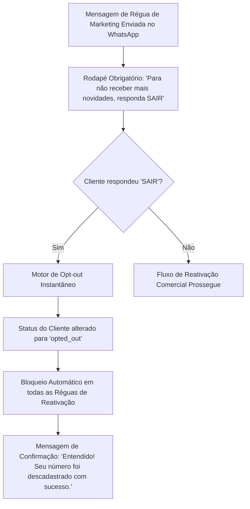

# SECURITY & COMPLIANCE: ARQUITETURA DE SEGURANÇA E CONFORMIDADE LGPD (V1)

---

## 1. Modelo de Autenticação e Autorização

### 1.1 Autenticação Segura Baseada em Tokens
- **Tokens de Acesso (Access Tokens):** Emitidos no padrão **JWT (JSON Web Token)** assinado com algoritmo **RS256** (chaves assimétricas pública/privada) ou HS256 com segredo de 256 bits rotacionado. Validade curta de **15 minutos**.
- **Tokens de Atualização (Refresh Tokens):** Validade de **7 dias**, armazenados em cookies HTTP-Only, Secure e SameSite=Strict no navegador, associados a uma sessão com identificador único persistido no Redis.
- **Rotação Atômica de Refresh Token:** A cada renovação de sessão, o refresh token anterior é imediatamente invalidado. Se um token já utilizado for apresentado novamente, o sistema detecta tentativa de sequestro de sessão e revoga imediatamente todas as sessões ativas daquele usuário.

### 1.2 Controle de Acesso Baseado em Papéis (RBAC)
Cada requisição à API é submetida a um interceptor de autorização que valida a tupla:
$$\{\text{tenant\_id}, \text{user\_id}, \text{role}, \text{resource}, \text{action}\}$$

- **`ADMIN` (Proprietário):** Acesso irrestrito a faturamento, conexão WhatsApp WABA, taxas de maquininha, relatórios financeiros e exportação de dados.
- **`MANAGER` (Gerente de Loja):** Acesso a todas as conversas da loja, gestão do funil, transferência de leads, configuração de réguas e relatórios de SLA de vendedores. Bloqueado para desconectar o canal WABA e exportar carteira sem autorização do Admin.
- **`SELLER` (Vendedor de Balcão):** Acesso restrito e exclusivo às conversas atribuídas a ele na roleta e aos seus próprios cards de negociação. Bloqueado para visualizar faturamento global, relatórios de outros vendedores ou alterar taxas de maquininha.

---

## 2. Proteção de Ativos Comerciais e Prevenção de Vazamento de Carteira

No mercado de varejo de smartphones, um dos maiores medos do lojista é que um vendedor comissionado copie a lista de clientes para abrir um negócio concorrente ou levar para outra loja:

1. **Blindagem contra Exportação em Massa:**
   - O endpoint de exportação de contatos e relatórios (`GET /api/customers/export`) é restrito exclusivamente ao perfil `ADMIN`.
   - A execução de qualquer download de base exige confirmação obrigatória de segundo fator de autenticação (**2FA via WhatsApp ou OTP por e-mail**).
2. **Logs de Auditoria Imutáveis (Audit Trails):**
   - Toda tentativa de exportação, alteração de taxas de maquininha, transferência manual de lead ou alteração de perfil de usuário gera um registro de auditoria gravado em tabela protegida, contendo: `user_id`, `ip_address`, `user_agent`, `timestamp` e `action_payload`.

---

## 3. Criptografia e Gestão de Segredos

### 3.1 Criptografia em Trânsito
- **HTTPS Obrigatório:** Todas as conexões externas utilizam protocolo TLS 1.3 obrigatório com HSTS (*HTTP Strict Transport Security*) ativo e certificado SSL com renovação automática.
- **WebSockets Seguros (WSS):** Toda comunicação em tempo real de mensagens trafega sob canal seguro WSS.

### 3.2 Criptografia de Credenciais Sensíveis em Repouso
- Chaves de acesso da Meta (*WABA System User Tokens*), credenciais de integração de adquirentes e segredos de webhook são armazenados no banco de dados criptografados com algoritmo simétrico **AES-256-GCM**.
- O vetor de inicialização (IV) é único para cada registro e o hash de autenticação (Auth Tag) previne adulteração dos dados criptografados.
- As senhas dos operadores nunca são salvas em texto puro; utilizam derivação de chave com **Argon2id** com salt individual por usuário.

---

## 4. Conformidade com a Lei Geral de Proteção de Dados (LGPD)

O tratamento de dados pessoais de clientes finais obedece estritamente às diretrizes da Lei nº 13.709/2018 (LGPD):

### 4.1 Base Legal do Tratamento:
- **Execução de Contrato (Art. 7º, V da LGPD):** Para envio de termos de garantia digital (D+0), status de entrega de pedidos e comunicações diretas solicitadas pelo cliente.
- **Legítimo Interesse (Art. 7º, IX da LGPD):** Para ofertas de revisão preventiva (D+180) e upgrade (D+360) a clientes que já possuem relação comercial prévia com a loja, com garantia incondicional e imediata de *Opt-Out*.

### 4.2 Direito de Exclusão e Anonimização (Art. 18 da LGPD):
- O painel administrativo disponibiliza o recurso de **Anonimização de Titular de Dados**: remove permanentemente Nome, Telefone e Notas Pessoais do cliente, preservando unicamente os registros numéricos e fiscais agregados necessários para a contabilidade da loja.

---

## 5. Proteção de Infraestrutura e Borda

1. **Rate Limiting e Proteção contra DoS:**
   - Limitação de taxa na camada de borda (Nginx/Cloudflare):
     - Endpoints de autenticação (`/api/auth/login`): Máximo de 5 tentativas por minuto por IP.
     - Endpoints gerais da API: Máximo de 120 requisições por minuto por usuário autenticado.
     - Endpoint de Webhook da Meta (`/webhooks/meta`): Lista branca (whitelist) de ranges de IPs oficiais da Meta ou validação estrita do cabeçalho `x-hub-signature-256`.
2. **Headers de Segurança HTTP:**
   - `Content-Security-Policy (CSP)` restrito, bloqueando injeção de scripts maliciosos.
   - `X-Frame-Options: DENY` (previne ataques de Clickjacking).
   - `X-Content-Type-Options: nosniff`.
