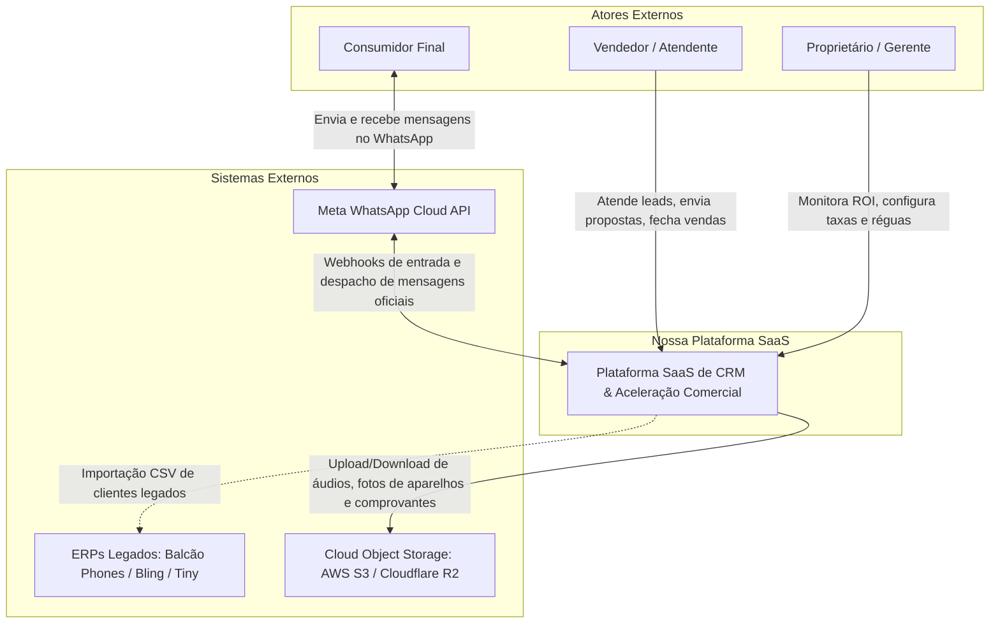
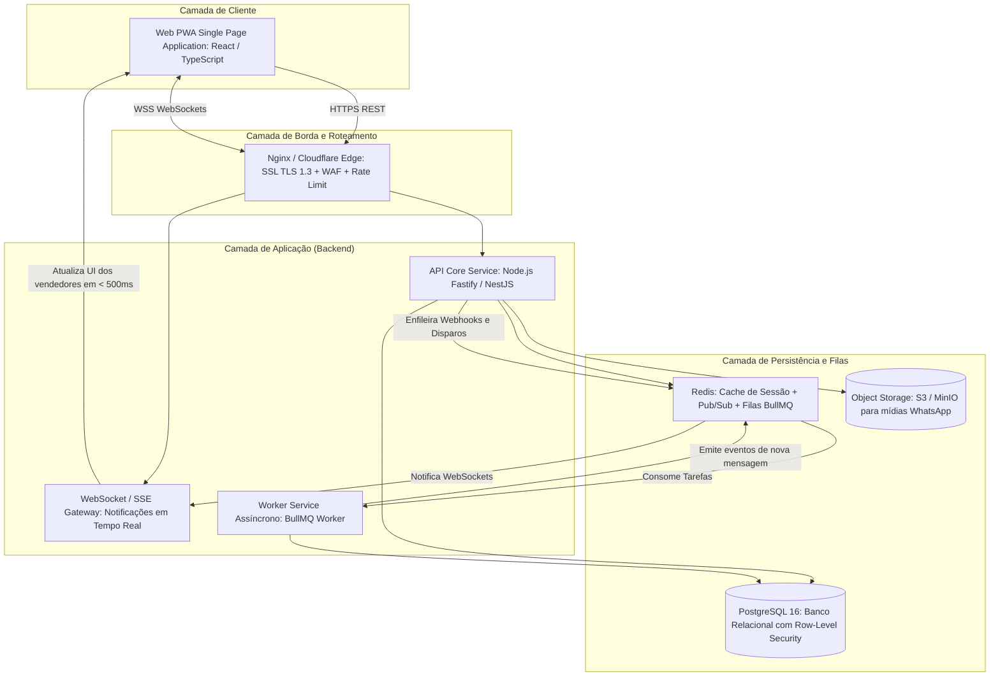

# SYSTEM ARCHITECTURE: ARQUITETURA DO SISTEMA E DESIGN TÉCNICO

---

## 1. Visão Geral e Estilo Arquitetural

Para atender aos requisitos de alta velocidade de entrega, robustez operacional, custo controlado de infraestrutura no estágio inicial e latência mínima nas trocas de mensagens no WhatsApp, o sistema adota o padrão de **Monolito Modular de Alta Performance (Modular Monolith) orientado a Eventos**.

### Por que Monolito Modular e não Microsserviços Distribuídos no MVP?
1. **Zero Sobrecarga de Rede Interna:** As transações entre módulos (CRM, Calculadora, Registro de Dispositivos e Réguas) ocorrem em memória no mesmo processo, eliminando a latência de chamadas gRPC/REST inter-serviços.
2. **Consistência Transacional Estrita (ACID):** Operações como *Conclusão de Venda + Criação de Ficha do Aparelho + Agendamento de Régua D+0* ocorrem sob a mesma transação de banco de dados, prevenindo dados órfãos.
3. **Fronteiras de Domínio Isoladas:** Cada módulo de negócio possui seus próprios controllers, serviços de aplicação e entidades de domínio, permitindo extração futura para microsserviços independentes (ex: Worker de Mensageria Meta) sem necessidade de refatoração do código base.

---

## 2. Diagrama de Arquitetura (Modelo C4)

### 2.1 C4 - Nível 1: Diagrama de Contexto do Sistema



### 2.2 C4 - Nível 2: Diagrama de Contêineres



---

## 3. Stack Tecnológica Recomendada e Justificativas

| Camada | Tecnologia Escolhida | Justificativa Técnica |
| :--- | :--- | :--- |
| **Backend Runtime** | **Node.js (LTS v20+) com TypeScript** | Ecossistema maduro, processamento assíncrono de I/O altamente eficiente para concorrência de webhooks e mensagens em tempo real. |
| **Web Framework** | **Fastify (ou NestJS com Fastify Engine)** | Desempenho até 2x superior ao Express tradicional, com validação de schemas em alta velocidade via JSON Schema/TypeBox. |
| **Banco de Dados** | **PostgreSQL 16** | Confiabilidade transacional máxima (ACID), suporte nativo a JSONB para metadados de aparelhos e recursos avançados de isolamento via *Row-Level Security (RLS)*. |
| **Cache & Mensageria** | **Redis 7 (com BullMQ)** | Gerenciamento de filas assíncronas de alta performance para webhooks da Meta, pub/sub para eventos de WebSocket e controle de concorrência com travas distribuídas (*distributed locks*). |
| **Frontend Web** | **React 18+ com TypeScript + Vite** | Padrão da indústria para SPAs de alta performance, tempo de carregamento instantâneo, ecossistema rico e suporte a PWA com Service Workers para uso móvel em loja física. |
| **Comunicação Realtime** | **Socket.io / Server-Sent Events (SSE)** | Transmissão bidirecional de mensagens recebidas, notificações de SLA estourado e movimentações de cards no Kanban. |
| **Armazenamento de Mídia**| **Cloudflare R2 ou AWS S3** | Armazenamento de áudios, imagens de aparelhos enviados por clientes e fotos de avarias de trade-in sem custo abusivo de tráfego de dados. |

---

## 4. Estratégia de Multi-Tenancy (Isolamento de Lojas)

O isolamento dos dados de cada loja cliente adota o modelo de **Banco Compartilhado com Separação Lógica Reforçada por Row-Level Security (RLS)**:

```
┌────────────────────────────────────────────────────────┐
│  REQUISIÇÃO HTTP DO VENDEDOR / GERENTE                 │
│  Header: Authorization: Bearer <JWT com tenant_id>     │
└────────────────────────────────────────────────────────┘
                           │
                           ▼
┌────────────────────────────────────────────────────────┐
│  MIDDLEWARE DE AUTENTICAÇÃO DO BACKEND                 │
│  1. Valida assinatura e expiração do JWT.              │
│  2. Injeta tenant_id no contexto de execução assíncrona│
└────────────────────────────────────────────────────────┘
                           │
                           ▼
┌────────────────────────────────────────────────────────┐
│  POOL DE CONEXÕES COM O POSTGRESQL                     │
│  Antes de cada query, executa:                         │
│  SET LOCAL app.current_tenant_id = 'tenant-xyz';       │
└────────────────────────────────────────────────────────┘
                           │
                           ▼
┌────────────────────────────────────────────────────────┐
│  TABELAS DO BANCO (POSTGRESQL RLS ATIVO)               │
│  CREATE POLICY tenant_isolation_policy ON customers    │
│  USING (tenant_id = current_setting('app.tenant_id')); │
└────────────────────────────────────────────────────────┘
```

### Garantias do Modelo:
- **Proteção a nível de banco:** Mesmo que um desenvolvedor esqueça de incluir `WHERE tenant_id = ?` em uma consulta SQL no backend, o motor do PostgreSQL impede que dados de outra loja sejam retornados ou alterados.
- **Eficiência de Custos:** Permite atender centenas de pequenas e médias lojas na mesma instância de banco de dados, sem o custo proibitivo de manter milhares de bancos separados.
