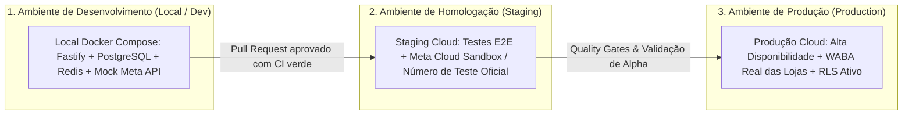
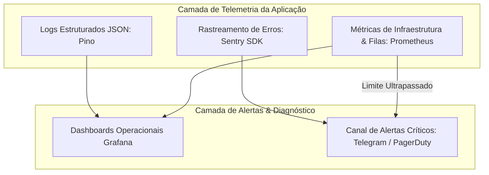

# DEPLOYMENT & ROLLOUT STRATEGY: IMPLANTAÇÃO, LANÇAMENTO E OBSERVABILIDADE (V1)

---

## 1. Topologia de Ambientes e Infraestrutura

O ciclo de vida da aplicação é segregado em três ambientes estritamente isolados:



| Ambiente | Provedor / Tipo | Finalidade Principal | Base de Dados |
| :--- | :--- | :--- | :--- |
| **Development** | Local / Docker Compose | Desenvolvimento diário e testes unitários. | PostgreSQL e Redis locais temporários. |
| **Staging** | Cloud (VPS/PaaS isolado) | Homologação de webhooks reais e testes de integração com número de teste oficial da Meta. | PostgreSQL gerenciado com dados sintéticos/anonimizados. |
| **Production** | Cloud com Replicação | Atendimento às lojas reais, conexões oficiais WABA e alta disponibilidade. | PostgreSQL 16 com backups diários automáticos e Point-in-Time Recovery (PITR). |

---

## 2. Pipeline de CI/CD e Deploy Sem Downtime (Zero Downtime Deploy)

- **Esteira Automatizada (GitHub Actions):**
  1. *Linting & Type Checking:* Validação estrita de TypeScript (`tsc --noEmit`) e ESLint.
  2. *Automated Tests:* Execução da suíte completa de testes unitários e de integração.
  3. *Build & Containerização:* Criação de imagens Docker otimizadas multi-stage para backend e frontend estático.
  4. *Deploy Automatizado:* Estratégia de **Rolling Update** (atualização progressiva de contêineres sem indisponibilidade para os vendedores conectados no WebSocket).

---

## 3. Estratégia de Rollout em 3 Fases (Lançamento Controlado)

```
[ Fase 1: Alpha Fechado ] ──────► [ Fase 2: Beta Controlado ] ──────► [ Fase 3: General Availability ]
• 3 a 5 lojas parceiras          • 20 a 30 lojas ativas             • Lançamento comercial aberto
• Onboarding 100% assistido      • Validação de CAC e Churn         • Escala de tráfego e vendas
• Ciclo diário de feedback       • Teste de suporte escalável       • Campanhas ativas de canal
• Duração: 2 semanas             • Duração: 4 semanas               • Operação contínua
```

### 3.1 Fase 1: Alpha Fechado (Design Partners)
- **Público Alvo:** 3 a 5 lojas reais de celulares no perfil ideal (ICP Nível 2: 2 a 5 vendedores, faturamento entre R$ 150k e R$ 400k/mês).
- **Protocolo de Implantação:**
  - Setup presencial ou por videoconferência assistida com o proprietário.
  - Importação da base legada de clientes via CSV no primeiro dia.
  - Acompanhamento em tempo real durante as primeiras 48 horas de atendimento no balcão.
  - Canal direto no WhatsApp entre os vendedores e o time de produto para ajustes de fricção de UX.

### 3.2 Critérios de Liberação para o Beta:
- Pelo menos 1 venda recuperada via réguas automáticas em cada loja participante do Alpha.
- Feedback de satisfação dos vendedores com a Calculadora de 1 Clique (redução comprovada de tempo de elaboração de proposta).
- Zero incidentes de perda de mensagens ou bloqueio de número comercial.

---

## 4. Observabilidade, Telemetria e Monitoramento em Produção

Para garantir estabilidade contínua sem depender de relatos de clientes para descobrir problemas, a plataforma adota uma pilha moderna de observabilidade:



### 4.1 Rastreamento de Erros e APM:
- **Sentry:** Monitoramento em tempo real de exceções no frontend (React) e backend (Node.js/Fastify), agrupando erros por versão de release e enriquecendo com dados contextuais de requisição (sem dados sensíveis de clientes).

### 4.2 Métricas de Saúde das Filas do WhatsApp:
- O tamanho da fila de webhooks no Redis BullMQ é monitorado segundo a segundo.
- **Gatilho de Alerta Crítico (P0):** Se a fila de webhooks da Meta ultrapassar **1.000 mensagens pendentes por mais de 2 minutos**, um alerta com prioridade máxima é enviado imediatamente ao plantão de engenharia.

### 4.3 Plano de Rollback Imediato:
- Caso um deploy recente em produção apresente taxa de erro `HTTP 5xx > 1%` nos primeiros 5 minutos após a publicação, a esteira executa rollback automático para a imagem Docker estável anterior em menos de **60 segundos**.
