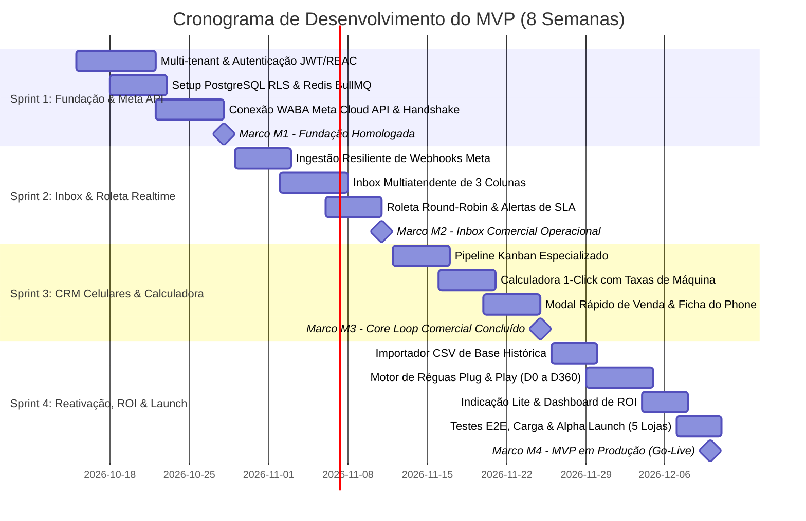

# SPRINT PLAN & MILESTONES: CRONOGRAMA DE DESENVOLVIMENTO E MARCOS DO MVP

---

## 1. Visão Geral do Ciclo de Entrega (Timebox de 8 Semanas)

Para garantir agilidade máxima e entrada segura no mercado com o menor custo de capital, o desenvolvimento da Versão 1.0 (MVP) é estruturado em **4 Sprints quinzenais (2 semanas por Sprint)**, totalizando um ciclo de **8 semanas de desenvolvimento até o lançamento em produção (Go-Live)**.

---

## 2. Detalhamento dos Sprints

### 2.1 Sprint 1: Fundação Multi-Tenant, Segurança e Conexão com a Meta API
- **Período:** Semanas 1 e 2.
- **Objetivo Principal:** Estabelecer a infraestrutura de dados com isolamento multi-tenant absoluto e homologar a comunicação bidirecional com a Meta WhatsApp Cloud API.
- **Entregáveis Técnicos:**
  - Configuração do banco PostgreSQL com as tabelas fundamentais (`tenants`, `users`, `card_fee_settings`).
  - Implementação das políticas de *Row-Level Security (RLS)* no banco.
  - Módulo de autenticação com JWT e rotação segura de Refresh Tokens.
  - Endpoint de verificação de Webhook da Meta (`GET /webhooks/meta`) e handshake oficial de assinatura HMAC SHA256.
- **Critério de Saída da Sprint:** Usuário Admin consegue logar, cadastrar sua loja e validar a conexão com a Meta API.

---

### 2.2 Sprint 2: Ingestão de Mensagens, Inbox Multiatendente e Roleta com SLA
- **Período:** Semanas 3 e 4.
- **Objetivo Principal:** Colocar o WhatsApp da loja para funcionar na interface web com velocidade realtime e distribuição automática de atendentes.
- **Entregáveis Técnicos:**
  - Pipeline de ingestão desacoplada: endpoint de webhook enfileirando payloads no Redis BullMQ com resposta em < 100ms.
  - Worker assíncrono com desduplicação por WAMID e persistência de mensagens.
  - Gateway WebSocket (Socket.io) para transmissão instantânea de novas mensagens.
  - Interface do Inbox de 3 colunas (desktop e versão adaptada para PWA mobile).
  - Algoritmo da Roleta de atendimento (Round-Robin) com detecção de SLA (verde, amarelo e vermelho).
- **Critério de Saída da Sprint:** Uma mensagem enviada de um celular real para o número da loja toca na tela do vendedor correto em menos de 1 segundo.

---

### 2.3 Sprint 3: Pipeline Comercial de Celulares, Calculadora 1-Click e Venda
- **Período:** Semanas 5 e 6.
- **Objetivo Principal:** Permitir que o vendedor qualifique leads, envie propostas calculadas e conclua vendas com registro de garantia do aparelho.
- **Entregáveis Técnicos:**
  - Quadro Kanban com estágios especializados de smartphones e arrasto de cards.
  - Módulo da Calculadora Comercial: cadastro de taxas da máquina e simulação instantânea de parcelamento de 1x a 21x com abatimento de trade-in e entrada Pix.
  - Ação de 1 clique para formatar proposta com emojis e enviar direto no chat do cliente.
  - Modal rápido de "Venda Concluída" (< 30 segundos) gravando modelo, IMEI, saúde de bateria e acessórios.
- **Critério de Saída da Sprint:** Vendedor executa o ciclo completo de negociação, simulação e fechamento sem sair da plataforma.

---

### 2.4 Sprint 4: Ingestão de Base Antiga, Motor de Reativação, Indicação e Dashboard
- **Período:** Semanas 7 e 8.
- **Objetivo Principal:** Fechar o loop de retenção e prova de valor econômico (ROI), preparando o sistema para clientes reais.
- **Entregáveis Técnicos:**
  - Importador CSV guiado com validação e higienização de telefones no padrão WhatsApp.
  - Cron Worker de Réguas Automáticas: disparos agendados em D+0 (termo de garantia), D+15 (acessórios), D+180 (revisão) e D+360 (upgrade).
  - Disparo do link de Indicação Lite pós-venda e rastreamento de cupons.
  - Dashboard Executivo com cartão de destaque de ROI (faturamento resgatado vs custo da ferramenta) e tabela de performance por vendedor.
  - Testes de carga simulando picos de mensagens e homologação com 3 lojas pilotos (*Alpha Fechado*).
- **Critério de Saída da Sprint:** O lojista importa sua base, dispara a primeira régua e visualiza o retorno financeiro no dashboard.

---

## 3. Gestão de Marcos de Entrega (Milestones)

| Marco | Nome do Marco | Critério Obrigatório de Aprovação |
| :--- | :--- | :--- |
| **M1** | **Fundação Homologada** | Zero vazamento de dados entre lojas testado via RLS + Autenticação 100% segura. |
| **M2** | **Inbox Comercial Operacional** | Latência de entrega de mensagem < 1.500ms + Roleta funcionando perfeitamente. |
| **M3** | **Core Loop de Venda Concluído** | Proposta enviada em < 45 segundos + Venda concluída e registrada em < 30 segundos. |
| **M4** | **Lançamento em Produção (Go-Live)** | Sistema em produção atendendo as primeiras 5 lojas piloto com zero erros críticos. |
