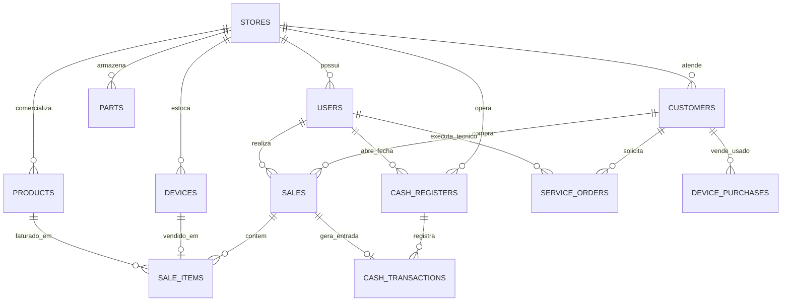
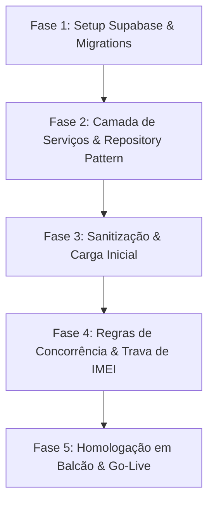

# Plano Diretor: Transição Segura para Dados Reais — Hiago iPhones ERP

> **Objetivo:** Estabelecer a arquitetura definitiva de banco de dados, regras de integridade e o roteiro seguro de implantação para migrar o sistema do estado atual (dados mockados/demonstrativos) para **operação real na loja física**, garantindo zero perda de vendas, concorrência segura por IMEI e conformidade financeira.

---

## 1. Diagnóstico do Estado Atual vs. Requisitos de Produção

| Aspecto | Estado Atual (Frontend Mockado) | Requisito com Dados Reais (Produção) |
|---|---|---|
| **Armazenamento** | Memória do React / Estado local | Banco de Dados Relacional Nuvem (Supabase / PostgreSQL) com backup diário |
| **Persistência** | Um refresh (`F5`) reseta dados adicionados | Dados salvos permanentemente e sincronizados em tempo real |
| **Multi-usuário** | Cada aba/navegador vê apenas sua sessão | Vendedores, técnicos e o caixa veem o mesmo estoque e status de O.S. instantaneamente |
| **Integridade de IMEI** | Validação básica de string | Restrição `UNIQUE` no banco, trava contra venda dupla concorrente do mesmo aparelho |
| **Segurança & Permissões** | Todos os botões acessíveis | Perfis com RLS (*Row Level Security*): Vendedor não visualiza preço de custo nem exclui vendas |
| **Controle de Caixa** | Estado simulado na tela | Auditoria imutável: cada centavo vinculado ao operador, data/hora e transação |

---

## 2. Arquitetura de Dados Alvo (Supabase / PostgreSQL)

O modelo relacional foi desenhado especificamente para a operação vertical de lojas de iPhone e assistência técnica:



### 2.1 Principais Tabelas e Restrições de Integridade

1. **`stores` (Multi-loja / Identidade do Lojista)**
   - `id` (UUID, PK), `name` ("Hiago iPhones"), `cnpj_cpf`, `whatsapp`, `pix_key`, `receipt_notes`, `created_at`.
2. **`users` (Controle de Acessos)**
   - `id` (UUID, PK), `store_id` (FK), `name`, `email`, `role` (`admin`, `gerente`, `vendedor`, `tecnico`), `pin_code` (4 dígitos para login rápido de balcão).
3. **`devices` (Estoque Inteligente por IMEI)**
   - `id` (UUID, PK), `store_id` (FK), `imei` (`VARCHAR(15) UNIQUE NOT NULL`), `model` (ex: "iPhone 13 128GB"), `color`, `condition` (`seminovo` | `lacrado`), `battery_health` (`INT`, null se lacrado), `aesthetic_grade` (`A+`, `A`, `B`), `cost_price` (`NUMERIC(10,2)`), `selling_price` (`NUMERIC(10,2)`), `status` (`em_estoque`, `reservado`, `vendido`, `em_garantia`), `supplier_id` (FK), `inflow_date`.
4. **`device_purchases` (Compra de Telefone / Trade-in)**
   - `id` (UUID, PK), `customer_id` (FK), `model`, `imei`, `battery_health`, `purchase_price`, `anatel_status` (`clean`, `restricted`), `contract_signed` (`BOOLEAN`), `trade_in_sale_id` (FK opcional se usado como entrada de outro iPhone).
5. **`service_orders` (Ordens de Serviço Técnicas)**
   - `id` (UUID, PK), `os_number` (`SERIAL`), `customer_id` (FK), `device_model`, `device_imei`, `checklist_in` (`JSONB`: 15 itens com 4 estados), `fault_reported`, `technical_diagnosis`, `parts_cost`, `labor_cost`, `total_price`, `status` (`aguardando_analise`, `em_bancada`, `aguardando_peca`, `pronto`, `entregue`), `technician_id` (FK).
6. **`cash_registers` & `cash_transactions` (Fluxo Financeiro Blindado)**
   - Abertura com operador e valor de troco;
   - Movimentações vinculadas: entradas automáticas do PDV/O.S., sangrias justificadas e reforços.

---

## 3. Roteiro de Implementação em 5 Fases



### Fase 1: Infraestrutura e Banco de Dados (Sem interrupção do front)
- [ ] Criar projeto Supabase dedicado (região São Paulo para latência < 25ms).
- [ ] Executar script DDL com índices em `imei`, `customer_id`, `status` e `created_at`.
- [ ] Configurar chaves seguras (`SUPABASE_URL`, `SUPABASE_ANON_KEY`) no Vercel e no `.env.local`.

### Fase 2: Camada de Serviços e Conexão Híbrida (Toggle Seguro)
- [ ] Implementar cliente em `src/services/supabaseClient.ts`.
- [ ] Implementar padrão **Repository** (`DeviceRepository`, `SaleRepository`, `CustomerRepository`).
- [ ] Inserir variável de ambiente:
  ```env
  VITE_DATA_SOURCE=mock    # Permite alternar entre mock e real a qualquer momento
  ```
  > [!TIP]
  > Essa abordagem garante que você pode testar o sistema com dados reais em uma rota de testes sem quebrar a versão atual que você já visualiza.

### Fase 3: Sanitização e Carga dos Dados Reais da Loja
- [ ] **Limpeza de Testes:** Expurgar dados fictícios de demonstração antes da carga oficial.
- [ ] **Cadastro do Estoque Atual:**
  - Opção A: Importação em lote da planilha atual de iPhones da loja via módulo **Migração de Dados** (`/dashboard/migracao`).
  - Opção B: Bipagem direta dos IMEIs com leitor óptico / câmera.
- [ ] **Validações Rígidas de Entrada:**
  - Validador do algoritmo de IMEI (15 dígitos).
  - Validador de WhatsApp com DDD para garantir que o pós-venda automático consiga disparar mensagens.

### Fase 4: Travas Críticas de Negócio (Blindagem Operacional)
- [ ] **Trava de Venda Dupla Concorrente:** Ao puxar um IMEI no PDV, o sistema reserva o aparelho por 10 minutos com trava transacional no banco (`SELECT FOR UPDATE`), impedindo que outro vendedor conclua a mesma venda.
- [ ] **Baixa Automática de Peças na O.S.:** Ao selecionar "Troca de Tela iPhone 11", o sistema deduz automaticamente 1 tela do estoque de peças técnicas.
- [ ] **Integridade do Caixa:** Apenas usuários com permissão de Gerente/Admin podem autorizar sangrias acima de R$ 500,00 ou conceder descontos superiores a 10%.

### Fase 5: Homologação no Balcão e Virada de Chave (Go-Live)
- [ ] **Simulação de 1 Turno Completo:**
  1. Abertura do caixa com R$ 200,00 de troco.
  2. Entrada de 1 seminovo comprado de cliente (Trade-in) com contrato emitido.
  3. Entrada de 1 O.S. com checklist de entrada impresso.
  4. Venda de 1 iPhone lacrado + 1 película com pagamento misto (PIX + Cartão).
  5. Fechamento de caixa com conferência cega.
- [ ] **Virada de Chave Oficial:** Alterar `VITE_DATA_SOURCE=real` no Vercel.

---

## 4. Matriz de Riscos & Planos de Contingência

| Risco Identificado | Impacto | Mecanismo de Prevenção / Contingência |
|---|---|---|
| **Queda de Internet na Loja** | Alto | O sistema manterá cache local com *IndexedDB* (PWA) permitindo registrar a venda e sincronizar com a nuvem assim que a conexão retornar. |
| **Digitação de IMEI Errado** | Médio | Validador de formato de 15 dígitos + integração com leitor de código de barras 2D/QR Code. |
| **Exclusão Acidental de Registros** | Crítico | *Soft Delete* obrigatório: nenhum aparelho, venda ou cliente é excluído fisicamente do banco (`deleted_at IS NULL`). |
| **Vendedor Vendo Preço de Custo** | Médio | Políticas RLS no Supabase filtram os campos de margem e custo na API caso o usuário não possua o papel `admin`. |

---

## 5. Checklist Pré-Lançamento (Antes do 1º Dado Real)

- [ ] Chaves de produção cadastradas no Vercel.
- [ ] Backups automáticos habilitados (Point-in-Time Recovery no Supabase).
- [ ] Dados fiscais e PIX da loja configurados em **Meu Perfil**.
- [ ] Impressora térmica 80mm configurada e testada para recibos e etiquetas.
- [ ] Equipe da loja cadastrada com seus respectivos PINs de acesso.
